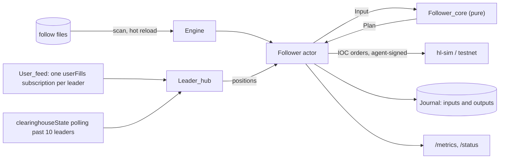

# hl-copy-engine

Copy-trading engine for Hyperliquid: mirrors a leader's positions into follower accounts,
scaled to each follower's capital and clamped by risk caps, with IOC orders signed by the
follower's approved agent.

Built with [OxCaml](https://oxcaml.org) and the Jane Street stack (Core, Async). The
mirroring math is the pure [hl-copy-core](https://github.com/winterchill-trading/hl-copy-core)
library (`Mirror`, `Scale`, `Caps`, `Rounding`, `Pnl`); this repository runs it against a
Hyperliquid API through [hl-client](https://github.com/winterchill-trading/hl-client)
(`User_feed`, `Client.trading_with_agent`, `Info`) and journals every input with
[market-data](https://github.com/winterchill-trading/market-data)'s `Framed` files. The
design is in the specs repository, `design/copytrading.md`.

**Simulator and testnet only.** Every entry point refuses a mainnet URL
(`api.hyperliquid.xyz` or any other `hyperliquid.xyz` host except
`api.hyperliquid-testnet.xyz`), whatever the flags say. Tests use throwaway keys made
inside the tests and run against [hl-sim](https://github.com/winterchill-trading/hl-sim)
in process.

## Run

```sh
# hl-sim with three simulated leaders, every /exchange request must be signed
(cd ../hl-sim && dune exec hl-sim -- -port 3000 -leaders 3 -strict-signatures) &

# The follower account approves an agent (in production the user's wallet signs this in
# the browser; this command is for local runs, keys come from the environment)
HL_USER_KEY=0x... HL_AGENT_KEY=0x... \
  dune exec hl-copy-engine -- approve-agent -user-key-env HL_USER_KEY -agent-key-env HL_AGENT_KEY

# Follow files, one per follow, as hl-copy-api writes them
mkdir -p follows journal
cat > follows/0xFOLLOWER-0x1eade50000000000000000000000000000000000.sexp <<'EOF'
((follower 0xFOLLOWER) (leader 0x1eade50000000000000000000000000000000000)
 (mode (Multiplier 0.1))
 (caps ((max_leverage (5)) (max_notional_per_symbol ()) (max_daily_loss ())
        (allowlist ()) (min_order_notional 10)))
 (slippage_bps 20) (paused false)
 (algo (Twap (duration_ms 60000) (slices 6) (max_participation ()))))
EOF

HL_AGENT_KEY=0x... dune exec hl-copy-engine -- run \
  -configs-dir follows -journal-dir journal -agent-key-env HL_AGENT_KEY -port 9930
curl -s localhost:9930/metrics; curl -s localhost:9930/status
```

`hl-copy-engine run` flags:

| Flag | Default | Meaning |
| --- | --- | --- |
| `-base-url`, `-ws-url` | `http://localhost:3000` | hl-sim or testnet; mainnet is refused |
| `-configs-dir` | required | directory of follow files (`*.sexp`), rescanned every `-scan-ms` |
| `-journal-dir` | none | per-follow journals; a restart replays them |
| `-port` | 9930 | `/metrics`, `/status`, `/healthz` |
| `-resync-s` | 30 | resync both accounts from `clearinghouseState` |
| `-scan-ms` | 1000 | rescan the follow files |
| `-max-ws-leaders` | 10 | leaders followed over the websocket; more are polled |
| `-leader-poll-s` | 5 | poll interval of the leaders past that limit |
| `-state-dir DIR` | | the API's state directory: sign with each follower's agent from `DIR/agents/<account>.key` |
| `-master-key-env VAR` | `HL_COPY_MASTER_KEY` | master key of the key store |
| `-agent-key-env VAR` | | sign with the agent key in `VAR` (development: one agent for every follow) |
| `-unsigned` | | send unsigned orders (hl-sim without `-strict-signatures` only) |
| `-builder ADDRESS` | none | builder put on follower orders (with `-builder-fee-tenths-bp`) |
| `-builder-fee-tenths-bp N` | none | builder fee, 1 to 100 tenths of a basis point (perps cap 0.1%) |
| `-log-level` | info | `debug`, `info` or `error`, on stderr |

`hl-copy-engine replay <journal-dir>/<follower>-<leader>` replays a follow's journal and
checks that every recorded output comes out the same (`-print` dumps the entries, `-state`
prints the final state); it exits non-zero on the first difference.

Agent keys: in production the engine shares the API's state directory (`-state-dir`,
mounted read-only) and opens each follower's agent from `Hl_copy_core.Key_store`
(`<state-dir>/agents/<account>.key`, sealed under `HL_COPY_MASTER_KEY`) in memory when the
follower starts (`Key_source.keystore_signer`); a missing or expired agent keeps the
follow from starting (state `error` in `/status`, retried as soon as the key file changes).
Every scan also reads each running follower's key file without decrypting it: a revoked
agent (file deleted) pauses the follow and cancels its orders, a rotated one restarts the
follower with the new key. The signer is a hook
(`Engine.Config.signer_for`, returning `Follower.Signer.Agent key`, `Hook sign` or
`Unsigned`), so tests and local runs can pass one key from the environment
(`-agent-key-env`) instead. Keys are never logged or printed.

## Builder fees

With `-builder ADDRESS -builder-fee-tenths-bp N`, every follower reads `maxBuilderFee` for
its account and that builder at start and on resyncs (every resync until the fee is
approved, then every 5 minutes, since the request weighs 20). While the approved cap is at
least `N`, follower orders carry `"builder": {"b": ADDRESS, "f": N}`; otherwise they go
out without it, counted in `hl_copy_builder_fee_skipped_total`, with the reason in the
follower's `/status` `builder.note`. A revoked approval shows up as an order refused over
the builder fee: the follower drops the field at once, and the next resync checks again.
The account approves the fee with its own wallet (`approveBuilderFee`; for local runs,
`Hl_client.Client.approve_builder_fee`).

## How a follow runs



- **Leader updates.** `Leader_hub` keeps one websocket (`Hl_client.User_feed`) with one
  `userFills` subscription per leader address, shared by every follower of that leader
  (Hyperliquid serves at most 10 distinct users per IP). A position update carries the
  price of the leader's latest fill in that coin, used as the mark. Leaders past
  `-max-ws-leaders` are polled with `clearinghouseState` (weight 2) rather than
  `userFills` (weight 20 plus 1 per 20 fills): the mirror copies positions, which the
  clearinghouse state gives directly, and polling it cannot miss a fill.
- **Rate limit.** One token bucket per engine (`Rate_limit`, 1200 weight per minute) paces
  every REST call: `meta` at start, resyncs, polls and exchange requests. Resyncing two
  accounts every 30 s costs 8 weight per minute per follower, so one IP carries about 150
  followers (pinned in `test_rate_limit.ml`).
- **One sequencer per follower.** Leader updates, resyncs, timers and commands are applied
  one at a time, each with its orders answered before the next starts, so a resync never
  races an order in flight (an open-orders snapshot taken mid-order would double the
  order).
- **Execution.** Each `Plan.Order` becomes an IOC at the mirror's limit (the mark plus
  `slippage_bps`, rounded so it never widens the bound) with a deterministic client order
  id, sent with `Client.trading_with_agent`. The order response is the fill: `filled`
  becomes a follower fill, `error` a reject. Fees are not in the response; the next
  resync's equity includes them.
- **Rejects.** Insufficient margin caps the account leverage at what the follower holds
  and records the shortfall (lifted by a resume, a new UTC day or a config change); an
  unknown or expired agent pauses the follow until the user approves again; a transport
  failure closes the orders and resyncs at once, because the order may have gone through.
- **Resync.** Every `-resync-s`, after a leader reconnect, and after a transport failure,
  both accounts are read from `clearinghouseState` and the marks from `allMids`; the
  mirror replaces its state with them and re-plans, which repairs missed fills,
  liquidations and manual trades.
- **Pause, resume, stop.** Pausing (from the follow file's `paused`, a call, or an agent
  reject) cancels the follow's open orders and keeps tracking without placing; resuming
  re-plans; stopping (file removed) cancels and closes the journal.
- **Journal and replay.** Every input and the output it produced are appended as Bin_prot
  frames (`Journal`, headed by the entry type's digest, one file per UTC day under
  `<journal-dir>/<follower>-<leader>/`). `Follower_core` reads no clock, so the inputs
  alone rebuild the state; a restart replays the journal (client order ids continue where
  they stopped) and then resyncs before sending anything.

## Execution algorithms

Each follow names how the orders its mirror plans are executed, in the follow file's
`algo` field (`Hl_copy_core.Exec_algo`, left out for the default `Immediate`, so older
files and the API's files read unchanged). The algorithms are
[execution-algos](https://github.com/winterchill-trading/execution-algos)'s:

| `algo` | Execution of a planned order |
| --- | --- |
| `Immediate` (default) | one IOC at the mirror's limit, as before algorithms existed |
| `(Twap (duration_ms D) (slices N) (max_participation ()))` | `N` IOC slices over `D` |
| `(Vwap ...)` | like TWAP, slices sized by a volume profile (uniform in the engine: no history) |
| `(Pov (participation R) (max_duration_ms D))` | IOC children at `R` of the market volume since the parent started |
| `(Passive (display F) (timeout_ms T))` | one add-liquidity-only child pegged to the best price on its side (`F < 1` shows only part: an iceberg), then an IOC for the rest at `T` |
| `(Adaptive (small_ratio 0.5) (depth_bps 10) (max_behind_bps 50) (max_drift_bps 10) (timeout_ms 20000))` | passive when the order is small against the depth near the mid and the follower is not far behind; taking when it is large, when the mid moves away, or at the timeout |

How it runs:

- Every planned place is a *parent* in `Follower_core` (`Exec`), worked by an
  `Execution_algos.Scheduler`. The mirror counts the parent as in flight until its
  scheduler is done, including across resyncs (open parents are added to the resync's
  open orders), so a parent is never planned twice. Child `k` has the parent's client
  order id with `k` in bits 40 and up of its sequence half; child 0 is the parent's own
  id, so an `Immediate` follow sends exactly what it sent before.
- Parents below the minimum order notional (a full close of a small position) always go
  out as one IOC.
- Algorithms other than `Immediate` need the market: the follower opens the venue's public
  websocket feed (`Hl_client.Live_feed`, L2 and trades) for the coin on first use and
  applies a `Market` input (time, top 20 levels, cumulative traded size) to its parents
  every 500 ms (`Follower.Config.algo_tick`). Ticks are journaled like every input.
- Post-only children are sent with `Order_type.alo`; their fills arrive on the follower's
  own `userFills` subscription (`Hl_client.User_feed`), opened the first time a child
  rests. IOC fills still come from the order answer.
- Each finished parent produces an `Execution_algos.Cost_report` (arrival slippage
  against the mid at the first tick, implementation shortfall including the move missed
  by what did not fill, fees, children, outcome). IOC fees are not in the answer and are
  estimated at 4.5 bp (1.5 bp for resting fills) in the report. Reports are journaled in
  the outputs, counted in the metrics and listed in `/status` under `execution`
  (`active` parents, the 20 most `recent` reports and `totals`).
- The journal moved to entries version 2 (`<date>.v2.journal`, inputs with the follow's
  algo and the `Market` ticks, outputs with post-only ids and reports). Version 1 files
  (`<date>.journal`) still load and replay; their outputs are compared on plan and
  notices only.

## No-trade band

A follow file may carry a `band` (`Hl_copy_core.No_trade_band`, left out of files
without one, so the API's files and older ones read unchanged). The mirror then sends a
rebalance only when the gap between the follower's position (plus in-flight orders) and
its target is outside a band whose half-width is `cost x equity / (risk_aversion x vol^2)`
(USD notional), and trades to the band's edge (part of the way for the quadratic-cost
variant); a leader close is always copied in full. See hl-copy-core's README for the
derivation.

```text
(band ((fee_bps 4.5) (slippage (Fixed_bps 5)) (risk_aversion 20) (vol_bps 300)
       (cost_model Proportional)))
```

- The cost is `fee_bps` plus the slippage: a fixed estimate, or `(Impact (fallback_bps
  5))`, where the follower opens the coin's market feed and, on every market tick, walks
  the book with execution-algos' `Impact.estimate` for the order that would close the
  current gap (one lot when there is none); the estimate is set in the mirror from the
  journaled tick, so a replay sets the same one.
- A rebalance the band holds back is a `Within_band` note in the output's plan (gap,
  half-width, the fee and slippage it would have cost), journaled with every output;
  `hl_copy_band_skips_total` and `hl_copy_band_saved_usd` count them, and `/status` shows
  the follower's `band`: its config, half-width at the configured cost, skips, saved cost,
  the per-coin slippage estimates and the last 20 skips.
- The journal moved to entries version 3 (`<date>.v3.journal`: follow configs with the
  band, plans with `Within_band` notes). Version 2 and 1 files still load and verify.

## Metrics

`/metrics` (Prometheus text, labels `follower` and `leader`): `hl_copy_leader_updates_total`,
`hl_copy_orders_total`, `hl_copy_fills_total`, `hl_copy_rejects_total{reason}` (margin,
no_liquidity, agent, rate_limited, other), `hl_copy_resyncs_total`,
`hl_copy_resync_failures_total`, `hl_copy_resync_repairs_total`, `hl_copy_lag_ms`
(summary: leader fill, exchange time, to follower order sent), `hl_copy_slippage_bps`
(summary: fill price against the mark, adverse positive), `hl_copy_realized_pnl_usd` and
`hl_copy_unrealized_pnl_usd` (`Hl_copy_core.Pnl` attribution, before fees),
`hl_copy_equity_change_usd`, `hl_copy_paused`, `hl_copy_builder_fee_orders_total` (orders
sent with the builder field), `hl_copy_builder_fee_skipped_total` (orders sent without it
because the follower has not approved the fee), `hl_copy_parents_total{algo,outcome}`
(finished parents), `hl_copy_arrival_slippage_bps` (summary, per filled parent),
`hl_copy_shortfall_usd` and `hl_copy_exec_fees_usd` (summed cost reports),
`hl_copy_band_skips_total` and `hl_copy_band_saved_usd` (rebalances the no-trade band held
back and their estimated cost); and per engine
`hl_copy_followers`,
`hl_copy_config_errors`, `hl_copy_rest_weight_total`.

`/status` (JSON): `{"followers": [...], "leaders": [...], "errors": [...]}`. Each
follower entry carries what hl-copy-api's `/me` reads, `follower`, `leader`, `state`
(`running`, `paused`, `stopped`, or `error` for a follow that could not start), `pnl`
(attributed, USD), `positions` (`coin`, `size`, `entry_px`, `unrealized_pnl`, `leverage`,
all numbers) and `last_error`, then details: its agent address, pause reason, the leader's source
(websocket or polling), both equities and positions, pending orders, margin cap,
shortfall, last resync, the metrics, `band` (`null` without one) and `builder` (`null` without `-builder`, else
`address`, `fee_tenths_bp`, `approved`, `max_approved_tenths_bp` and a `note` saying why
orders go out without the builder); the followed leaders with their follower counts;
follow files that failed to apply.

## End-to-end run

`scripts/e2e-sim.sh` builds hl-sim and the engine from the dune workspace, starts the
simulator with three leaders, 40 noise traders and strict signatures, approves an agent
for a throwaway follower key, writes one follow of leader 0 and runs the engine for 60 s,
printing both positions every 10 s, then the metrics, then replays the journal.

One run (seed 7, `(Multiplier 0.1)`, which copies sizes one for one since leaders hold
$100,000 and other accounts $1,000,000, 50 bps bound, resync every 10 s):

```
 10s  leader BTC=-1.47933   follower BTC=-0.80332
 20s  leader BTC=-0.03311   follower BTC=-0.06178
 30s  leader BTC=1.47512    follower BTC=0.64826
 40s  leader BTC=2.1719     follower BTC=1.07431
 50s  leader BTC=2.1719     follower BTC=1.53954
 60s  leader BTC=2.1719     follower BTC=2.18507
hl_copy_leader_updates_total 7     hl_copy_orders_total 13   hl_copy_fills_total 12
hl_copy_rejects_total{reason="no_liquidity"} 1                hl_copy_resyncs_total 7
hl_copy_lag_ms p50 1.75, p90 2.70, max 2.70
hl_copy_slippage_bps p50 4.8, p90 16.2
((entries 82) (inputs 41) (outputs 41) (orders 13) (identical true))
```

Lag (leader fill on the exchange to the follower's order leaving the engine) is 1 to 3 ms
on a laptop against the local simulator. The follower trails while the leader builds a
position because the simulated book is thin: the leader's own IOC orders take the
liquidity near the touch and each follower IOC fills partly, so the rest comes on the
following resyncs. With the default 10 noise traders and the 20 bps default bound, most
follower IOCs found nothing (7 `no_liquidity` rejects in 17 orders), which is why the
script raises both.

`ALGO` sets the follow's algorithm. Three 60 s runs on 2026-10-16 (seed 7, otherwise as
above; the leader's path differs between runs because the follower trades on the same
simulated book), from the script's `execution` summary of the finished parents:

| `ALGO` | Parents | Fill rate | Slippage (bps, filled) | Shortfall (bps of target) | Children | Journal replay |
| --- | ---: | ---: | ---: | ---: | ---: | --- |
| `Immediate` | 9 | 27.6% | 13.6 | 5.0 | 9 | identical |
| `(Twap (duration_ms 6000) (slices 3) ...)` | 9 | 99.99% | 1.3 | 5.8 | 28 | identical |
| default `Adaptive` | 9 | 99.93% | 6.6 | 11.0 | 21 | identical |

`BAND` sets the follow's no-trade band, and the script ends with a summary line: the
follower's fill records and fees (its `userFills`), the band's skips and saved cost, and
the tracking error (root mean square over the 5 s samples of `|target - position| x mid /
equity`, the target being the mode's image of the leader's position). Three 60 s runs on
2026-10-16 (seed 7, `SAMPLE_S=5`, `Immediate`, otherwise as above; the follower here has
$1,000,000, so the default band's half-width is about 52,800 USD, half a BTC):

| `BAND` | Orders | Fill records | Fees (USD) | Band skips | Saved (USD) | Tracking error (bps) | Journal replay |
| --- | ---: | ---: | ---: | ---: | ---: | ---: | --- |
| none | 9 | 227 | 100.77 | 0 | 0 | 611 | identical |
| `risk_aversion 200` (half-width 5,280 USD) | 8 | 255 | 106.13 | 1 | 3.90 | 1,167 | identical |
| default (`risk_aversion 20`) | 7 | 179 | 79.75 | 2 | 97.72 | 1,076 | identical |

With the default band the follower stopped at -1.77 BTC against the leader's -2.28 (a
gap of 51,000 USD, inside the edge) and paid a fifth less in fees for a larger tracking
error. The leader's path differs between runs (the follower trades on the same simulated
book) and most of the tracking error on this thin book is IOC remainders, so the three
rows compare costs more than tracking. With `(Impact (fallback_bps 5))` the follower
subscribed to the BTC book, journaled about 100 market ticks (129 inputs against 23 to 27 without) and replayed identically; its
slippage estimate was 3.4 bp.

On the thin simulated book a single IOC finds a fraction of the size within the bound
and leaves the rest to the next resync (the unfilled part counts in the shortfall at the
price move it missed); slicing waits for the noise traders to refill the book. The
shortfall includes the estimated taker fee (4.5 bp).

## Tests

`dune test` runs, with no network beyond loopback:

- `test_follower_core.ml`: the pure core: scaled targets, margin cap and its lifting,
  pause and resume, config changes, agent rejects, replay through bin_io, band skips in
  the outputs and Impact slippage estimates from market ticks.
- `test_journal.ml`: day files, reload, verification and a tampered output; version 1
  and version 2 files next to a version 3 one.
- `test_rate_limit.ml`, `test_reject.ml`, `test_metrics.ml`, `test_safety.ml`.
- `test_leader_hub.ml`: one leader over the websocket and one polled past the limit, two
  consumers each, against hl-sim.
- `test_follower_sim.ml`: hl-sim with strict signatures and an approved agent; the
  follower ends within a lot of its target after each leader change (open, flip, close),
  caps clamp, a resync repairs a dropped update, an insufficient-margin reject caps instead
  of retrying, and a restart continues the client order ids; the journal replays
  identically.
- `test_sim_leaders.ml`: following one of hl-sim's simulated leaders with noise traders
  making the market, through ten leader decisions.
- `test_key_source.ml`: the key store signer for missing, sealed, expired and
  wrong-master-key cases.
- `test_builder_sim.ml`: hl-sim with a builder fee: orders go out without the builder
  until the follower approves the fee, then carry it and the builder account is credited
  1 bp of the notional; after a revoke the refused order marks the approval gone and the
  retry goes out without it.
- `test_algo_sim.ml`: hl-sim with strict signatures, the follow worked by TWAP (three
  slices; the journal replays identically), passive (rests at the bid, sweeps at the
  timeout) and adaptive (rests, filled as the maker by a seller, the fill read from the
  follower's own `userFills`).
- `test_algo_bridge.ml`: the follow's algorithm type and execution-algos' have the same
  bin_prot shape and sexp.
- `test_engine.ml`: follow files start, pause, reconfigure and stop followers; `/metrics`
  and `/status`; mainnet refused.

## Interface

```ocaml
Hl_copy_engine.Safety.check_url : Uri.t -> unit Or_error.t
Hl_copy_engine.Follower_core     (* Input.t (Stable.V3, V1 and V2 read), Output.t
                                    (post_only, reports, band notes), Exec, apply,
                                    replay, market_symbols *)
Hl_copy_engine.Journal           (* Entry.Stable.V3 (V1, V2 read), Writer, load, verify,
                                    dir *)
Hl_copy_engine.Algo_bridge       (* Exec_algo.t <-> Execution_algos.Algo.t *)
Hl_copy_engine.Leader_hub        (* create, subscribe ~leader, source, leaders *)
Hl_copy_engine.Follower          (* Signer.t, Config.t, start, pause, resume, reconfigure,
                                    resync_now, stop, state, metrics, status_json *)
Hl_copy_engine.Engine            (* Config.t with signer_for, start ?port, followers, find,
                                    metrics_text, status_json, stop *)
Hl_copy_engine.Key_source.keystore_signer
  : Hl_copy_core.Key_store.t -> Follower_config.t -> Follower.Signer.t Or_error.t Deferred.t
```

hl-copy-api writes `Hl_copy_core.Follower_config.t` files into the engine's
`-configs-dir` (write, then rename), reads `/status` for its `/me` view, and will provide
the agent keys through `Engine.Config.signer_for`.

## Not done yet

- Fees per fill: taken from resync equity, not from `userFills`; PnL attribution is
  before fees.
- Address-based request limits, liquidation flags and a back-off of the resync interval
  under rate limiting (see the design's failure table).
- Execution algorithms: VWAP uses a uniform volume profile (no recorded trades in the
  engine); `hl_copy_lag_ms` has no samples for children sent on market ticks; the API and
  the web app do not offer an algorithm yet (set it in the follow file).

## Build

```sh
opam switch create 5.2.0+ox --repos ox=git+https://github.com/oxcaml/opam-repository.git,default
# pin the siblings in this order (see .github/workflows/ci.yml): fixed-decimal,
# exchange-core, parquet, market-data, hl-protocol, venue-net, hl-client, hl-copy-core,
# execution-algos, mm-core, binance-protocol, binance-client, order-book, exchange-core-engine,
# price-anchor, hl-sim
opam install . --deps-only --with-test
dune build && dune test
```

hl-client signs with `libsecp256k1` (`brew install secp256k1`, `libsecp256k1-dev` on
Debian and Ubuntu). CI uses the org's `ox-setup` action, which caches the switch.
